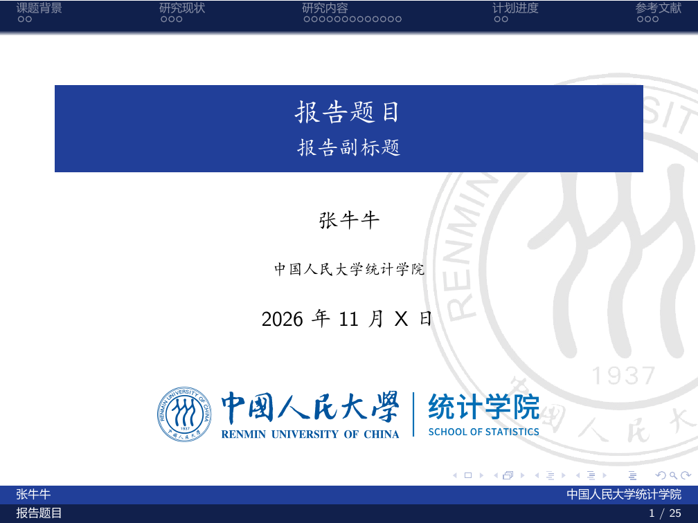
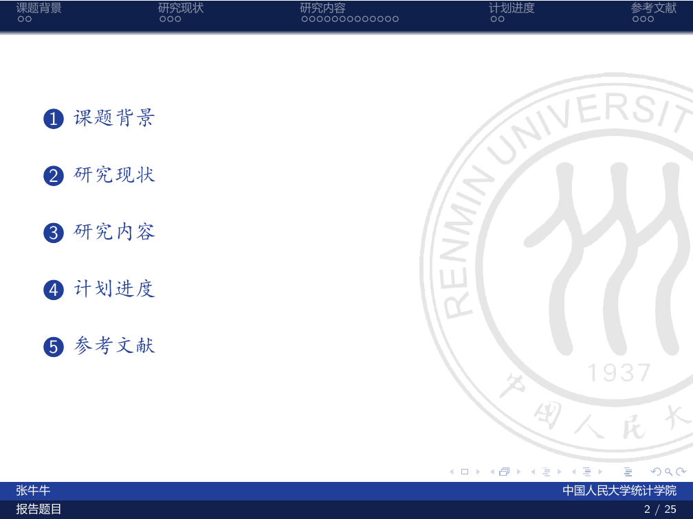
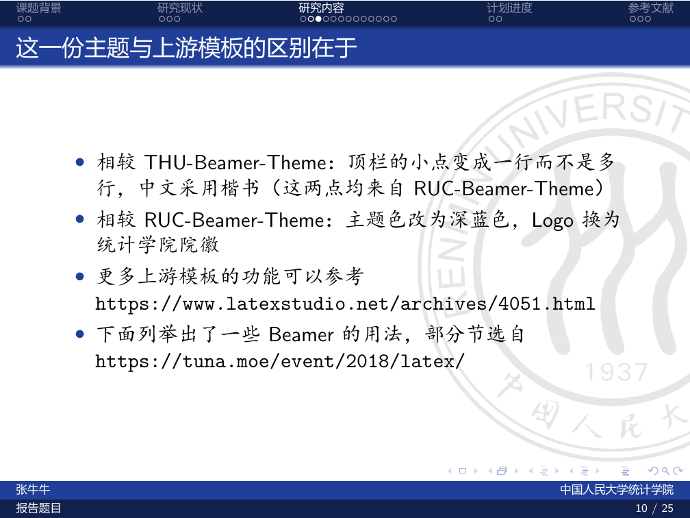
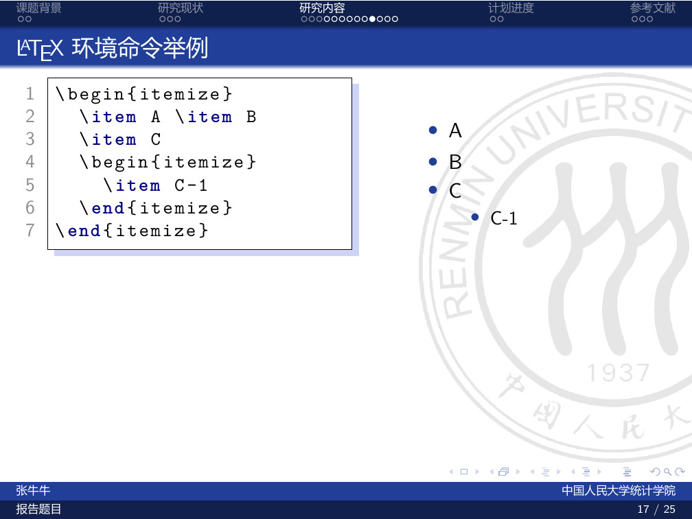

# RUC-Stat-Beamer

A LaTeX Beamer theme template for the School of Statistics, Renmin University of China.

中国人民大学统计学院 Beamer 模板。

## 预览

| 封面 | 目录 |
|:---:|:---:|
|  |  |
|  |  |
| 内容页与顶栏章节导航 | 公式排版 |

## 模板来源与致谢

本模板在 [GohUnTsuan/RUC-Beamer-Theme](https://github.com/GohUnTsuan/RUC-Beamer-Theme) 的基础上修改而成，感谢 GohUnTsuan 同学！

RUC-Beamer-Theme 源自 [Trinkle23897/THU-Beamer-Theme](https://github.com/Trinkle23897/THU-Beamer-Theme)（现由清华大学 TUNA 协会维护），感谢 Trinkle！

THU-Beamer-Theme 最早能追溯到的版本是 [https://www.latexstudio.net/archives/4051.html](https://www.latexstudio.net/archives/4051.html)。示例幻灯片中部分 Beamer 用法节选自 TUNA 的 LaTeX 介绍：<https://tuna.moe/event/2018/latex/>。

## 相较上游模板的改动

- 主题色由人大红（#971F30）改为深蓝色（#213F99）
- 封面与示例页 Logo 换为统计学院院徽（`pic/RUCstat_logo.png`）
- 院系信息改为中国人民大学统计学院，主题文件更名为 `RUC_Stat.sty`

## 使用方法

1. 将 `RUC_Stat.sty` 与 `pic/` 文件夹放在与主文件相同的目录下；
2. 在导言区加载主题：`\usepackage{RUC_Stat}`；
3. 修改 `\author`、`\title`、`\institute` 等信息后即可使用。

## 编译说明

模板使用 `ctex` 宏包处理中文，请使用 XeLaTeX 编译。Beamer 顶栏的章节导航依赖第一次编译生成的导航文件（`.nav`），请连续编译两次：

```text
xelatex slide.tex
xelatex slide.tex
```

如需参考文献，可在两次编译之间运行 `bibtex slide`。编译效果可参考仓库中的 `slide.pdf`。

## License

本项目沿用 MIT 许可证（继承自 RUC-Beamer-Theme），详见 [LICENSE](LICENSE)。上游 THU-Beamer-Theme 采用 LPPL-1.3c 许可证。
